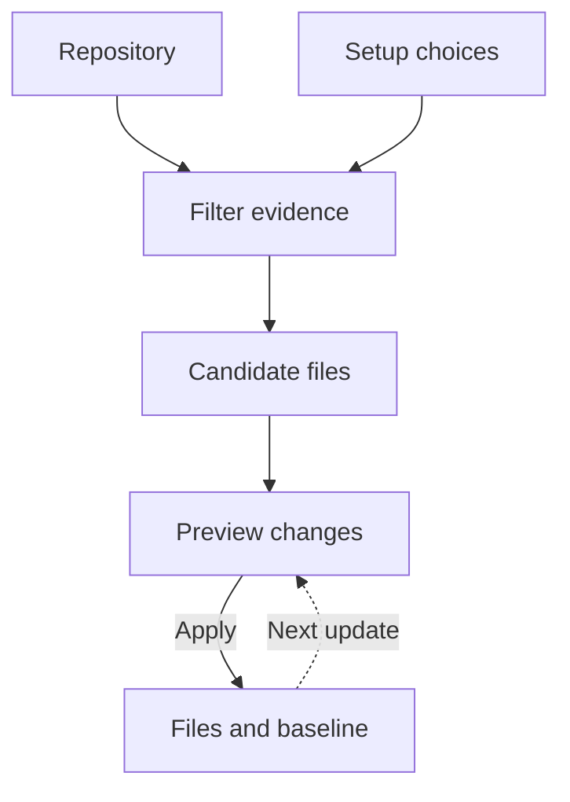

# Rigup

[](https://github.com/ansonli-dev/rigup/actions/workflows/ci.yml) · [npm](https://www.npmjs.com/package/@ansonli.dev/rigup) · [Portable releases](https://github.com/ansonli-dev/rigup/releases) · [简体中文](README.zh-CN.md)

Rigup sets up coding-agent workflows for an existing repository. It uses source evidence and your integration choices to prepare project guidance, skills, and configuration you can review before applying.

[What it sets up](#what-rigup-sets-up) · [Quick start](#quick-start) · [How it works](#how-it-works) · [Integrations](#integrations) · [Commands](#commands) · [Documentation](https://github.com/ansonli-dev/rigup/blob/main/docs/README.md)

## What Rigup sets up

- **Project guidance.** Turn source, tests, and existing conventions into scoped instructions and references to the project's build and test commands.
- **Spec-driven workflows.** `change-prepare` connects the agent to the selected workflow's planning and approval steps. `change-deliver` connects it to the native implementation and verification steps.
- **Tools and checks.** Configure selected MCP tools and skills, and wire existing project checks into Git hooks or GitLab CI.

An applied Codex setup with OpenSpec includes these workflow files.

```text
AGENTS.md                               # Managed workflow links
.agents/skills/change-prepare/SKILL.md  # Prepare a change and obtain approvals
.agents/skills/change-deliver/SKILL.md  # Implement and verify the change
.rigup/manifest.json                    # Ownership and baseline references
```

## Quick start

### 1. Install

With Node.js 24 or later, install from npm.

```sh
npm install -g @ansonli.dev/rigup
rigup --version
```

The macOS and Linux installer downloads a bundle with Node.js and links `rigup` into `~/.local/bin`.

```sh
curl -fsSL --proto '=https' https://raw.githubusercontent.com/ansonli-dev/rigup/main/install.sh | sh
```

Use Git and `ps` on the host. Linux needs glibc 2.35 or newer, including when using WSL2. [Install, upgrade, and pin a version](docs/guides/releases.md)

### 2. Set up a project

```sh
cd /path/to/project
rigup init
```

The guide asks for missing choices, including the language of generated project documents. Pass `--language zh-CN` to choose Simplified Chinese, or use the default `auto` to follow the project's guidance. Local Codex uses your existing login for semantic research. This non-interactive preview makes zero model calls.

```sh
rigup init --agents codex --sdd none --tools none --dry-run --json
```

### 3. Review and use the installed workflow

In review mode, inspect the preview and end any affected agent sessions. Run the reported `nextCommand` from a separate terminal, then reopen the agent. Where a native workflow is configured, start with the installed `change-prepare` and `change-deliver` skills. `rigup doctor` reports setup and reload status. [Apply and recovery](docs/guides/usage.md#应用与恢复)

## Project development rules

With a development workflow selected, Rigup links original guidance and identifies undocumented conventions in code. When evidence supports them, `docs/rigup/development-rules.md` records when each rule applies, what to do, how to verify it, and which source lines support it.

The two installed skills carry applicable rules into native proposals and task execution. They point agents to existing tests and hook definitions so each change can reuse the checks that cover it. [Project workflow and language](docs/guides/usage.md#项目研发流程)

## How it works



1. **Select evidence.** Rigup scans the configured scope within file and byte budgets and filters sensitive inputs. For semantic generation, the plan, content, and acceptance stages each receive excerpts selected for that task. Lockfile digests contribute to the project fingerprint that validates cached results. [Research and budgets](docs/guides/usage.md#研究后端与预算)
2. **Build a preview.** Rigup assembles generated guidance, fixed templates, and integration settings into candidate files. The preview shows file edits, conflicts, and pending operations such as tool initialization.
3. **Apply and update.** Rigup rechecks the preview and records the files, configuration keys, and marked blocks it manages. An update compares the saved baseline, the current file, and the new candidate. Non-overlapping edits can merge. Conflicts preserve the local content for review, and saved run state supports resuming interrupted work. [Protected apply and recovery](docs/guides/usage.md#应用与恢复)

## Integrations

- Agent adapters cover Codex, Claude Code, OpenCode, and Oh My Pi. [Tested combinations](docs/compatibility/status.md)
- Prepare the official Superpowers, OpenSpec, or Spec Kit entry points before selecting that workflow. [Workflow prerequisites](docs/guides/usage.md#命令与引导)
- Rigup builds the CodeGraph index in staging and verifies it before promotion. It connects OpenWiki over MCP and hands off wiki generation to a separate session. [Tool setup](docs/guides/usage.md#openwiki-和-codegraph)

Installed MCP runners, hooks, and CI scripts use Node on the consuming environment's PATH. [Platform and runtime requirements](docs/guides/releases.md)

## Commands

```sh
rigup                    # Open the project menu in a terminal
rigup init               # Set up the current project
rigup update --review    # Prepare a reviewable update
rigup update --configure # Reopen the setup guide
rigup doctor             # Inspect setup status
rigup --help             # Show all options
```

`init`, `update`, and `doctor` are subcommands. Pass a project path after the command to work in another directory. Use options such as `--review` and `--json` to choose execution mode or output.

## Contribute

Run `npm ci` and `npm run check` from the source checkout. [Development](docs/guides/development.md) · [Contributing](CONTRIBUTING.md) · [Security](SECURITY.md) · [Changelog](CHANGELOG.md)

[MIT](LICENSE) · [Third-party notices](THIRD_PARTY_NOTICES.md)
