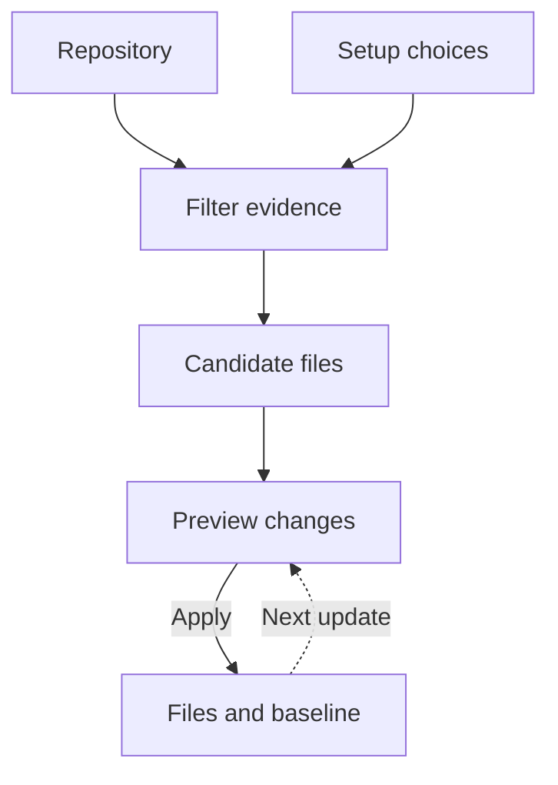

# Rigup

[](https://github.com/ansonli-dev/rigup/actions/workflows/ci.yml) · [npm](https://www.npmjs.com/package/@ansonli.dev/rigup) · [Portable releases](https://github.com/ansonli-dev/rigup/releases) · [简体中文](README.zh-CN.md)

Rigup sets up coding-agent workflows for an existing repository. It uses source evidence and your integration choices to prepare project guidance, skills, and configuration you can review before applying.

Run `rigup init` at the project root. Once setup completes, close Rigup and use the installed workflow with your agent.

[What it sets up](#what-rigup-sets-up) · [Quick start](#quick-start) · [How it works](#how-it-works) · [Integrations](#integrations) · [Commands](#commands) · [Documentation](https://github.com/ansonli-dev/rigup/blob/main/docs/README.md)

## What Rigup sets up

- **Project guidance.** Turn source, tests, and existing conventions into scoped instructions and references to the project's build and test commands.
- **Spec-driven workflows.** `change-prepare` connects the agent to the selected workflow's planning and approval steps. `change-deliver` connects it to the native implementation and verification steps.
- **Tools and checks.** Configure selected MCP tools and skills, and reuse project-owned Git hooks or configure native GitLab jobs.

An applied Codex setup with OpenSpec includes these workflow files.

```text
AGENTS.md                               # Managed workflow links
.agents/skills/change-prepare/SKILL.md  # Prepare a change and obtain approvals
.agents/skills/change-deliver/SKILL.md  # Implement and verify the change
.rigup/manifest.json                    # Installer metadata for updates and recovery
```

## Quick start

### 1. Install

Use Node.js 22.19 or later in the 22.x line, or Node.js 24.2 or later.

```sh
npm install -g @ansonli.dev/rigup
rigup --version
```

PowerShell accepts a quoted comma-separated list or one flag per value.

```powershell
rigup init . --agents claude --sdd none --tools 'openwiki,codegraph' --defer-research --review --json
```

The macOS and Linux installer downloads a bundle with Node.js and links `rigup` into `~/.local/bin`.

```sh
curl -fsSL --proto '=https' https://raw.githubusercontent.com/ansonli-dev/rigup/main/install.sh | sh
```

For native Windows, use the npm installation with a supported Windows Node.js version, PowerShell 7, and Git for Windows. Use directory names made of ASCII letters, digits, hyphens, and underscores for the Rigup npm prefix, project, and temporary paths. [Installation and Windows path requirements](docs/guides/releases.md#npm)

The portable installer uses Git and POSIX tools including `ps`. Linux needs glibc 2.35 or newer, including when using WSL2. [Install, upgrade, and pin a version](docs/guides/releases.md)

### 2. Set up a project

```sh
cd /path/to/project
rigup init
```

The guide asks for missing choices, including the language of generated project documents. The default first-run option installs the base setup and Rigup MCP without model calls. Open the configured agent and ask it to use Rigup MCP to prepare rules. To generate them from the terminal, configure an Anthropic or OpenAI-compatible provider and run `rigup update --review`. Use `--language zh-CN` for Simplified Chinese or `auto` to follow the project's guidance. [Research and budgets](docs/guides/usage.md#研究后端与预算)

Selecting OpenSpec checks its CLI and project entry points right away. Confirm automatic setup to install the pinned OpenSpec CLI in a writable npm prefix on PATH and add missing native files. If you prepare the prerequisites manually, rerun `rigup init` to resume your host and OpenSpec selections.

This non-interactive command previews a minimal setup without model calls.

```sh
rigup init --agents codex --sdd none --tools none --defer-research --dry-run --json
```

### 3. Review and use the installed workflow

From an independent terminal, you can approve the OpenSpec foundation preview in the same session. In review mode, inspect the preview and end any affected agent sessions. Run the reported `nextCommand` from a separate terminal, then reopen the agent. Use `change-prepare` to propose a change and `change-deliver` to implement and verify it after approval. [Apply and recovery](docs/guides/usage.md#应用与恢复)

## Project development rules

Rigup prepares rules through either the configured agent or the CLI provider. It verifies source citations and builds a scoped index at `docs/rigup/development-rules.md` that links original guidance and pages under `development-rules/`. Each page covers the rules, exceptions and checks for its topic. Source excerpts and review notes stay in private run records.

The two installed skills carry applicable rules into native proposals and task execution. They point agents to existing tests and hook definitions so each change can reuse the checks that cover it. [Project workflow and language](docs/guides/usage.md#项目研发流程)

## How it works



1. **Select evidence.** Rigup scans the configured scope within file and byte budgets and filters sensitive inputs. For semantic generation, the plan, content, and acceptance stages each receive excerpts selected for that task. Lockfile digests contribute to the project fingerprint that validates cached results. [Research and budgets](docs/guides/usage.md#研究后端与预算)
2. **Build a preview.** Rigup assembles generated guidance, fixed templates, and integration settings into candidate files. The preview shows file edits, conflicts, and pending operations such as tool initialization.
3. **Apply and update.** Rigup rechecks the preview and records the files, configuration keys, and marked blocks it manages. An update compares the saved baseline, the current file, and the new candidate. Non-overlapping edits can merge. Conflicts preserve the local content for review, and saved run state supports resuming interrupted work. [Protected apply and recovery](docs/guides/usage.md#应用与恢复)

## Integrations

- Agent adapters cover Codex, Claude Code, OpenCode, and Oh My Pi. [Tested combinations](docs/compatibility/status.md)
- The first-run guide can set up OpenSpec. Superpowers and Spec Kit use the project's existing official entry points. [Workflow prerequisites](docs/guides/usage.md#命令与引导)
- Rigup builds the CodeGraph index in staging and verifies it before promotion. It connects OpenWiki over MCP and hands off wiki generation to a separate session. [Tool setup](docs/guides/usage.md#openwiki-和-codegraph)

After setup, agents use their native workflow and MCP configuration, along with the project’s existing tools and checks. Project-local Node MCP entries need Node.js on the host agent's PATH, including when the CLI itself comes from the portable bundle. [Platform and runtime requirements](docs/guides/releases.md)

## Commands

```sh
rigup                    # Open the project menu in a terminal
rigup init               # Set up the current project
rigup update --review    # Prepare a reviewable update
rigup update --configure # Reopen the setup guide
rigup doctor             # Inspect setup status
rigup --help             # Show all options
```

`init`, `update`, and `doctor` are subcommands. Pass a project path after the command to work in another directory. Use options such as `--review` and `--json` to choose execution mode or output.

## Contribute

Run `npm ci` and `npm run check` from the source checkout. [Development](docs/guides/development.md) · [Contributing](CONTRIBUTING.md) · [Security](SECURITY.md) · [Changelog](CHANGELOG.md)

[MIT](LICENSE) · [Third-party notices](THIRD_PARTY_NOTICES.md)
