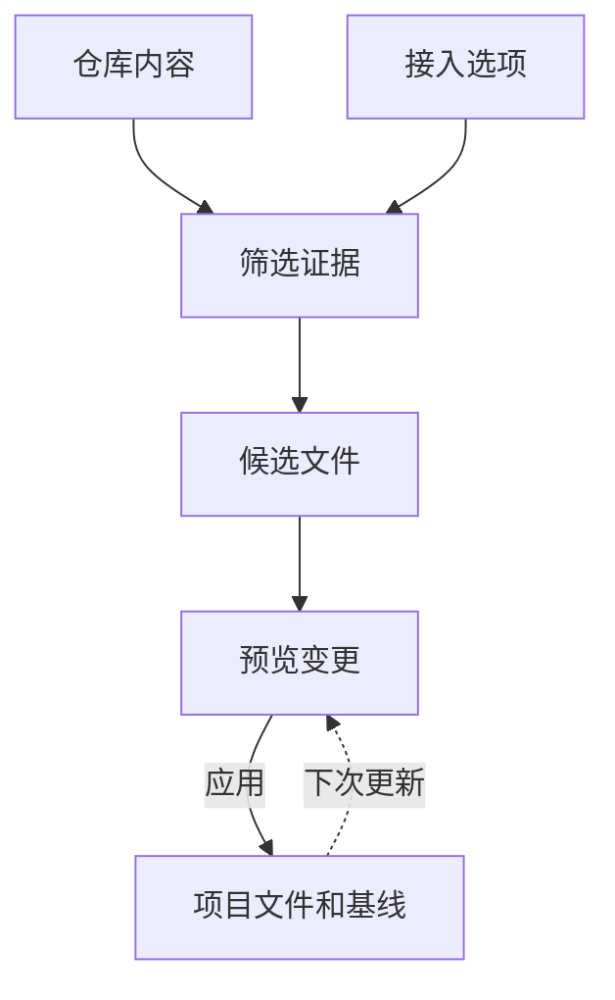

# Rigup

[](https://github.com/ansonli-dev/rigup/actions/workflows/ci.yml) · [npm](https://www.npmjs.com/package/@ansonli.dev/rigup) · [便携版下载](https://github.com/ansonli-dev/rigup/releases) · [English](README.md)

Rigup 为已有仓库配置编程 agent 的研发流程。它根据源码证据和你选择的接入项准备项目指引、skills 和配置，应用前可预览具体变更。

在项目根目录运行 `rigup init`。初始化完成后即可退出 Rigup，打开 agent 使用项目里已安装的工作流。

[Rigup 能做什么](#rigup-能做什么) · [快速开始](#快速开始) · [工作原理](#工作原理) · [接入范围](#接入范围) · [命令速查](#命令速查) · [文档](https://github.com/ansonli-dev/rigup/blob/main/docs/README.md)

## Rigup 能做什么

- **项目指引。** 从源码、测试和已有约定提取适用范围明确的指引，并记录项目现有的构建和测试命令。
- **规格驱动研发流程。** `change-prepare` 接入所选流程的规划和审批，`change-deliver` 接入原生的实施和验证步骤。
- **工具和工程检查。** 按需配置 MCP、安装 skills，并复用项目已有的 Git hooks 或配置原生 GitLab 作业。

以 Codex 搭配 OpenSpec 为例，应用后会生成这些流程文件或托管区块。

```text
AGENTS.md                               # 托管区块中的流程入口
.agents/skills/change-prepare/SKILL.md  # 准备变更并取得审批
.agents/skills/change-deliver/SKILL.md  # 实施并验证变更
.rigup/manifest.json                    # 安装器用于更新和恢复的元数据
```

## 快速开始

### 1. 安装

通过 npm 安装时，使用 Node.js 22.x（22.19 起）或 24.2 及以上版本。

```sh
npm install -g @ansonli.dev/rigup
rigup --version
```

在 PowerShell 中，用引号包住逗号分隔列表，也可以为每个值重复选项。

```powershell
rigup init . --agents claude --sdd none --tools 'openwiki,codegraph' --defer-research --review --json
```

macOS 和 Linux 也可以通过安装器下载内置 Node.js 的便携版。安装器会将 `rigup` 链接到 `~/.local/bin`。

```sh
curl -fsSL --proto '=https' https://raw.githubusercontent.com/ansonli-dev/rigup/main/install.sh | sh
```

原生 Windows 使用 npm 安装，需要受支持的 Windows Node.js、PowerShell 7 和 Git for Windows。Rigup 的 npm 安装目录、项目目录和 `TEMP`、`TMP` 临时目录的各级目录名只支持英文字母、数字、连字符（`-`）和下划线（`_`）。含中文、空格或其他符号的路径不在支持范围内。[安装与 Windows 路径要求](docs/guides/releases.md#npm)

便携版安装器需要 Git 和 `ps` 等 POSIX 工具，Linux（含 WSL2）需要 glibc 2.35 或更新版本。[安装、升级与固定版本](docs/guides/releases.md)

### 2. 初始化项目

```sh
cd /path/to/project
rigup init
```

引导会补问缺少的设置，包括生成项目文档的语言。可以传 `--language zh-CN` 选简体中文，默认 `auto` 沿用项目指引的语言。首次设置默认安装基础接线和 Rigup MCP，再从已配置的 agent 生成项目规则。也可以配置 Anthropic 或 OpenAI 兼容服务，从终端执行 `rigup update --review`。下例用 `--defer-research` 做零模型调用的非交互预览。[研究入口与预算](docs/guides/usage.md#研究后端与预算)

```sh
rigup init --agents codex --sdd none --tools none --defer-research --dry-run --json
```

选中 OpenSpec 时，引导会立即检查 CLI 和项目入口。确认自动补齐后，Rigup 会把锁定版本的 OpenSpec 装到 PATH 上可写的 npm 前缀，并补齐所选宿主的原生文件。手动处理后再次运行 `rigup init` 会接着已选的宿主和 OpenSpec 继续。

### 3. 应用并重载

在独立终端完成 OpenSpec 基础初始化时，可以当场确认应用预览。在审阅模式中，先检查预览并结束受影响的 agent 会话，再从独立终端执行报告里的 `nextCommand`。重开 agent 后，用 `change-prepare` 发起提案，审批后用 `change-deliver` 实现和验证。[应用与恢复](docs/guides/usage.md#应用与恢复)

## 项目开发规范

通过宿主的 Rigup MCP 或终端的 provider 研究项目后，Rigup 核对引用的源码范围，在 `docs/rigup/development-rules.md` 生成索引。索引按适用范围链接原有指引和 `development-rules/` 下的主题规范。每个主题页写明开发要求、例外和验证方法。证据与验收记录保存在私有运行状态中。

两个流程 skill 将适用规则带入原生提案和任务执行，并指出已有的测试和 hook 定义，方便 agent 复用覆盖本次改动的检查。[研发流程与语言](docs/guides/usage.md#项目研发流程)

## 工作原理



1. **筛选证据。** Rigup 按设置的范围扫描仓库，限制读取的文件数和字节数，并过滤敏感输入。语义生成的规划、内容和验收阶段各自选取所需片段。锁文件的摘要也纳入项目指纹，用于校验缓存结果。[研究后端与预算](docs/guides/usage.md#研究后端与预算)
2. **生成预览。** Rigup 将项目指引、固定模板和接入配置组装成候选文件。预览列出文件改动、冲突和待执行的操作，例如工具初始化。
3. **应用和更新。** 应用前重新核对预览，成功后记录托管文件、配置键和标记区块。更新时比较已保存的基线、当前文件和新候选。非重叠改动可以合并，冲突会保留本地内容并交由用户处理。中断后可根据保存的运行记录继续。[受保护的应用与恢复](docs/guides/usage.md#应用与恢复)

## 接入范围

- Agent 配置适配覆盖 Codex、Claude Code、OpenCode 和 Oh My Pi。[已验证场景](docs/compatibility/status.md)
- OpenSpec 可在首次引导中准备。Superpowers 和 Spec Kit 使用项目已有的官方入口。[流程接入前置条件](docs/guides/usage.md#命令与引导)
- Rigup 在暂存区构建并验证 CodeGraph 索引，随后将索引移入项目。OpenWiki 通过 MCP 接通，由用户在独立会话生成 wiki。[工具设置](docs/guides/usage.md#openwiki-和-codegraph)

安装结束后，agent 使用宿主原生工作流、MCP 配置和项目已有工具。[平台与运行时要求](docs/guides/releases.md)

## 命令速查

```sh
rigup                    # 打开项目菜单
rigup init               # 初始化当前项目
rigup update --review    # 准备待审阅的更新
rigup update --configure # 重新打开设置引导
rigup doctor             # 检查项目状态
rigup --help             # 查看可用选项
```

`init`、`update` 和 `doctor` 是子命令。命令后可给项目路径，省略时使用当前目录。用 `--review`、`--json` 等选项选择执行方式或输出格式。

## 参与开发

在源码目录运行 `npm ci` 和 `npm run check`。[开发与测试](docs/guides/development.md) · [贡献指南](CONTRIBUTING.md) · [安全报告](SECURITY.md) · [变更记录](CHANGELOG.md)

[MIT](LICENSE) · [第三方声明](THIRD_PARTY_NOTICES.md)
