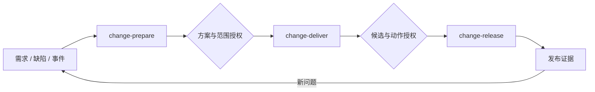

# 安装后的研发 Skills：执行与状态设计

日期：2026-11-02。状态：待评审的安装产物设计，未实现。

本文件只设计脚手架安装到项目的研发 skills。它们由 coding agent 执行，使用已安装的 SDD、工具 MCP、项目命令和客户系统；不依赖脚手架 CLI 在线，不调用 init/update，不承担 harness 安装维护。

相关文档：[脚手架安装与更新设计](2026-11-02-smart-harness-design.md)、[需求基线](../../requirements/2026-11-02-smart-harness-requirements.md)。

脚手架的生命周期是安装和更新；这里的生命周期是每次研发变更的准备、实施、交付和发布。二者通过 HarnessBundle 交付契约连接，版本与状态分别管理。

## 1. 公开入口与工作目标

### 1.1 Skill 清单

建议三个可按需安装的公开研发入口：

1. change-prepare：将需求、缺陷或事件形成可执行方案。
2. change-deliver：连续实现、检查、评估、提交及 CI/CR 修复。
3. change-release：在真实授权下集成/发布并验证结果，具备部署能力时选装。

harness init/update 等是脚手架命令，不是这里的 skill。项目 harness 的长期改进先形成配置/策略提案，用户可自行修改项目文件，或在需要时重新运行脚手架 update；不混入这条研发主线。

不另设公开的 code-review、test-run、ci-fix、handoff、resume、bug-fix、incident-triage 等入口。检查、评审、修复和恢复作为内部步骤，缺陷/事件通过 change-prepare 的输入模式进入。所选 SDD 自带 skills 不受本清单命名限制。

用户可停用或替换任意段。前一段在交接包说明由谁接手，不假设停用的下一段仍然存在。

### 1.2 change-prepare

输入：自然语言需求、工单、缺陷/事件证据，或已有规格；附目标仓库和 changeId。已批准的输入附权威来源与版本。

连续执行：

1. 读取规范、as-is 和代码关系，核实相关现状；缺陷模式增加复现与根因调查。
2. 明确范围、非目标、验收依据、风险和待定业务决策。
3. 对比方案并产出技术设计：数据/Interface 变化、影响范围、兼容与迁移、失败/回退处理。
4. 形成实现计划、可验证完成条件、执行范围和所需客户能力。
5. 内部一致性评估，修正无须人决定的问题。
6. 汇总未决事项与构建授权请求，交付一次可审阅的方案包。

产物角色为 intent、design/spec、plan、acceptance、risk；实际路径由 SDD adapter 返回，不强制另造五份同义文件。一个原生文件可以承担多个角色。

正常停止点是“方案与实施范围需要人决定”。若完整输入和实施授权已经存在且仍有效，则不重复请求审批，直接交给 change-deliver。业务含义不清或必须先选择技术路线时可提前询问，但不能因“写完一个文档”而停顿。

本段可修改规划文档，不修改业务实现。缺少项目测试时说明验证缺口，不将建设整个测试体系塞进计划；具体需求确实需要的测试工作由开发者确认其范围。

### 1.3 change-deliver

输入：已接受且未失效的方案包、实施授权、工作分支与框架产物。

连续执行：

1. 校验范围和输入版本，建立隔离工作区或复用客户指定分支。
2. 按计划实施；可按能力和风险拆成内部工作项，不固定引入 sprint。
3. 运行已有检查，针对本次需求执行授权的测试工作。
4. 以完成标准评估，按政策执行需要的独立评审；修复问题并复验。
5. 在允许范围内提交并创建/更新同一 MR，读取 CI 和 AI CR。
6. 对依据充分的同范围问题修复、推送、重新检查，直到形成可交付候选。
7. 准备部署/回退说明及审批所需证据，交接给 change-release。

不在实现、测试、评审和 CI 修复之间要求用户重启 skill。CI 未返回时等待或记录 awaiting_external；上下文不足时写交接点；预算用尽或问题需要业务决定才交接给人。

产物：diff/commits、检查记录、评审结果、MR、候选清单和未解决项。候选清单绑定具体提交、内容摘要和可获得的构建 artifact；有问题的候选不标为 ready。

独立评估在客户政策要求或选定评审模式下执行。宿主可使用独立上下文或外部 CI reviewer；只在同一上下文换个角色不能声明“独立评审”。必需评审能力缺失时报告阻塞，不悄悄降低要求。

发布前的集成是否由本段执行，取决于客户实际效果：普通非生产集成可预授权；若合并会触发生产发布，则在合并前进入对应发布 gate，不能先合并再请求授权。

无 MR/CI 扩展时，使用显式的 local 交付模式：完成本地实现、检查、评估和候选记录后结束，不声称 MR/远端 CI 已完成。gitlab 模式增加 MR、CI/CR 循环；若项目政策要求远端检查，则不能降为 local 规避门禁。两种模式由编译结果写明，不影响其他独立工具的安装。

### 1.4 change-release

输入：可交付候选、目标环境、有效动作授权，以及客户扩展提供的集成/部署、状态查询和回退入口。

连续执行：复核候选与审批 → 需要时合并 → 部署指定 artifact → 等待部署状态 → 运行已有冒烟/健康检查 → 在授权条件内回退或记录发布成功。

默认采用不可变 artifact 交付：change-deliver 通过客户已有构建入口产出 artifact，并在请求发布批准前冻结其摘要。change-release 只部署该对象，不以同名 tag 或当前分支重新构建替代。无构建/部署能力时可以完成本地交付，但不能报告已准备好自动发布。

客户采用“合并后构建”时，release 包含明确的 preflight 子步骤：先取得集成授权并合并，等待客户流水线构建，把新 artifact 和检查结果记入候选，再取得所需发布授权；同一 skill 内续跑。合并若会直接发布且无法在 CI 中阻断，则不支持这条自动发布路径，必须由客户调整门禁或改为外部人工发布。不能对尚不存在的构建产物无条件授权。

发布授权必须涵盖即将发生的真实效果；开发/测试环境可以按客户政策预授权。生产授权默认建议由客户指定负责人提供。已有有效授权时直接继续，不因进入新 skill 再问一次。

部署失败时区分重试、已授权回退和需要代码修改。前两者在 runbook/预算内执行；代码问题回到 change-deliver，同范围修复不重复讨论全部需求，但旧候选授权失效。新范围或不可逆处理重新交给人。

产物：部署 id、artifact/commit、目标环境、运行检查、回退结果和发布记录。缺少客户部署能力时报告“未接入”，不生成虚假的部署命令；该入口按需安装。

## 2. 人类决策与自动衔接

默认建议只有两个业务决策包：方案/实施授权，以及候选/集成发布授权。它们不是强制两个审批次数。

对每个有副作用动作按客户政策求值：

```text
已有授权覆盖当前对象、动作、环境和版本 → 连续执行
必须人决定且缺少有效决定                 → awaiting_human
必须外部审批/检查尚未返回                 → awaiting_external
被政策禁止、必需能力缺失                 → blocked
```

同一负责人可以在同一时点看完、且证据全部已就绪的决策合并为一个请求。不同审批人、不同就绪时机、职责分离要求和上游不可取消的 gate 必须保留。代码 owner 审批、变更委员会或生产审批若是客户现有要求，就是真实 gate，不能为减少次数而绕过。

自动步骤的分段、检查失败、上下文切换和 skill 加载都不自动产生人工审批点。技术阻塞仍可能终止自动执行，但应交付原因和恢复入口，不能伪装成人工批准即可解决。

示意主线：



图中决策若已被有效授权覆盖，则自动通过；客户额外必需 gate 在相关动作之前插入，不增加公开 skill。

## 3. 产物与研发状态

### 3.1 产物布局与权威来源

```text
.harness/
  bundles/<bundleId>/            # 已安装的版本化研发资产
    skills/
    runtime/
    bindings/
    manifest.json
  changes/<changeId>/            # 项目研发记录，installer 不覆盖
    change.yaml
    handoff.md
    delivery.yaml
    release.yaml
  state/runs/<runId>/             # 临时结果，不入库
```

SDD 原生规格、任务文件仍在框架目录；客户系统的权威记录仍在客户系统。change.yaml 存角色引用和版本，不复制第二套可独立漂移的规格正文。跨框架在途产物不自动迁移。

流程记录在有意义的交接/决策/提交检查点随工作分支保存；MR/CI/审批原始记录留在权威系统。凭据、完整会话和原始日志不提交。

运行中的共享状态位于 Git common dir 下的 harness/workflows/<changeId>/，包含 current.json、lease.json 和动作日志，所有本机 worktree 指向同一位置。分支内 change.yaml 是可审阅和跨会话交接的投影，不是多个 worktree 各自维护的运行权威。无本地共享状态时从最新交接产物及远端事实重建，并重新验证门禁和未完成动作。

### 3.2 ChangeRecord 与执行所有权

```yaml
schemaVersion: 1
changeId: example-change
bundleId: "<installed-bundle-id>"
kind: feature                 # feature | bug | incident | maintenance
phase: prepare                # prepare | deliver | release
status: awaiting_human
sequence: 4
framework: selected-profile
inputs:
  sourceRefs: []
  snapshotDigest: "<digest>"
  policyDigest: "<digest>"
artifacts:
  intent: { uri: "<native-or-external-ref>", digest: "<digest>" }
  design: { uri: "<native-ref>", digest: "<digest>" }
  plan: { uri: "<native-ref>", digest: "<digest>" }
scope:
  allowedPaths: []
  allowedEffects: []
  exclusions: []
progress:
  completedItems: []
  activeItem: null
  unresolved: []
evidenceRefs: []
gateRefs: []
next:
  action: accept-solution
  reason: "<decision-needed>"
```

这只是数据形状示例，不是可以直接执行的客户配置。范围和政策由真实输入填充，空字段不意味着允许全部路径或动作。

状态限定为 ready、running、awaiting_human、awaiting_external、blocked、succeeded、failed。phase 与 status 分离；succeeded 只表示该工作段完成，release 的部署失败不能被 deliver 成功掩盖。

每次 checkpoint 必须带 expectedSequence 和输入摘要。helper 用仓库/变更 id 锁加序号校验，原子写入，过期写者重读后再决定。研发锁使用 harness/workflows/ 命名空间，与 installer 的安装锁独立；不同变更允许独立运行，同一变更不能有两个写者覆盖状态。

写入锁之外，还需贯穿一段执行的 run lease：开始前 claim(changeId) 获取 ownerRunId 和 fencingToken，受控动作在执行前验证 token，动作意图先入日志再产生远端效果，checkpoint 也必须携带 token。进入人工/外部等待或正常结束时显式交接/释放执行权。进程中断后不因超时自动抢占，恢复者先核实旧执行已停止并对账在途动作，再生成新 token；旧写者和旧 token 被拒绝。

首版 lease 保证范围是同一 Git common dir 的本机 worktrees，不提供分布式锁服务。客户 CI 对同一 change 串行唤起；跨机器的外部写操作还必须依赖远端版本条件、动作幂等键和平台侧串行机制。发布扩展若不能提供这些保证，就不开放重叠自动发布，转为外部受控发布。任意人工绕过 helper 的操作不在工作流一致性保证内，仍由平台权限保护。

### 3.3 检查、候选与授权

检查记录绑定检查版本、命令、环境、代码内容摘要和阶段；commit 尚未产生时绑定工作区内容摘要，提交后补充对应 commit。证据不能只写“测试通过”。

delivery.yaml 的最小契约包含 changeId、方案/政策摘要、commit/tree 摘要、必需检查与评审证据、MR、artifact 的不可变摘要（如已构建）、目标动作、未决问题和 ready 状态。candidateDigest 对这些引用和版本做规范化摘要；ready 必须带 local-delivery、integration 或 release 的目标，不能用“本地可交付”冒充“可发布”。缺少该目标的必需结果时 ready 为 false。若目标动作需要的 artifact 尚未产生，不能对未知 artifact 请求无条件发布批准。

决策请求包含待决定事项、范围/风险、候选摘要、将发生的动作、目标环境、验证及回退条件。已有授权的复用必须匹配这些对象。

GateRequest 的必填字段为 id、changeId、subjectDigest、policyDigest、effects、environment、requiredAuthorities 和 evidenceRefs；GateDecision 记录 requestId、decision、决策来源/外部 id 及有效条件。方案级 subjectDigest 指向方案包，动作级指向具体候选及目标；helper 记录引用，受保护动作执行前由 extension 向权威系统复核。

发布动作的 subjectDigest 由不可变 artifact、源码树、目标环境、runbook/回退范围及政策摘要组成，不由可变分支名或 tag 代替。合并后若源码树或 artifact 改变，重新检查并请求该对象所需授权。仅 commit 元数据改变而源码树、artifact、目标和政策均可证明一致时，可按政策复用发布授权；受合并基线影响的检查仍需重跑。交付候选的审计记录同时保留合并前后 commit，不要求为纯元数据变化制造新的人工审批。

规格、政策、关键依赖或实现内容变化会使相关批准或检查失效；只失效实际依赖的部分，不无差别重做全部流程。代码内容修改一定使旧交付候选失效；重新构建 artifact 不同则不能沿用原 artifact 的发布授权。

审批记录不是权限凭据。客户要求强制审批的动作由 GitLab/部署系统等权威系统核实并执行；本地 YAML 中的 approved 字段或模型声称“已批准”不能取得生产权限。对话中的方案确认用于工作流意图，不能替代受保护分支或生产环境授权。

## 4. 续跑与长期任务

### 4.1 恢复协议与 bundle 固定

每个公开 skill 支持 changeId 的续跑，不另设 resume skill：

1. 读取 change.yaml、handoff.md、原生产物及权威状态。
2. 验证仓库、源码、政策和能力绑定版本。
3. 重查正在进行的远端动作，确认实际完成、失败或仍在运行。
4. 定位首个未完成且前置条件有效的工作项。
5. 同段续跑或加载已安装的下一段 skill；只有真实决策缺失才询问用户。

handoff.md 记录当前目标、已完成/未完成、证据引用、失败调查、下一步和权限限制，不复述全会话。上下文切换按需要发生，不强制每个工作项重启 agent，也不把模型上下文压缩视为批准失效。

当前会话中用户给出决定后直接恢复并衔接下一段，无需再输入下一条 skill 命令。宿主进程结束后不能假装 skills 会自行运行：无后台驱动时由用户续跑；配置客户 CI/webhook 驱动时由该系统重新唤起。CLI 不承担常驻调度。

Flow State 属于已安装资产，Interface 为 read / claim / checkpoint / record-evidence / resume。其 helper 以独立脚本随 bundle 分发，使用 manifest 声明的运行时，仅处理文件协议、执行所有权与校验，不 import installer、不调用脚手架 CLI。确定性 hooks/项目检查仍直接调用项目原生入口。

新任务读取默认 bundle 指针并固定 bundleId；续跑只加载 ChangeRecord 固定版本。脚手架更新默认版本不重置这次变更，不为其自动迁移状态。过期权威审批或新的平台政策仍须重新核实，不能靠旧 bundle 绕过。

### 4.2 外部等待、失败和幂等

创建 MR、触发流水线、部署等动作使用 changeId、分支、候选摘要等组成幂等键。超时后先查询实际结果，再决定重试，避免重复 MR 或重复发布。远端完成但本地记录丢失时按幂等键恢复。

同范围机械失败继续内部修复，不触发新的人工 gate；规则冲突、验收含义变化、超出授权范围、需受保护路径/不可逆操作时形成具体决策请求。

预算建议包括总耗时、模型预算、无进展轮次和重试上限；默认最多三轮连续修复作为可调整提案。需要人判断时提前停止，不通过放宽检查和改写验收标准制造成功。等待外部系统与耗尽主动修复预算分别记录。

## 5. 评估与反馈消费

内部评估读取已批准的完成标准，核对实际代码、运行行为及证据，不把实现者自评当最终事实。确定性检查先行；语义评审处理工具未覆盖的问题，按客户要求选择独立上下文，记录结论的不确定性。

修改后重跑受影响检查，段落交付前运行该阶段全部必需 gate。评审政策和证据不足时报告缺口，不自行更改测试覆盖门槛、架构约束或将历史失败加入豁免。

长期重复问题可以形成 harness 配置/策略改进提案：修改规范、skill 或检查接入方案。政策变更经用户审阅和相关回归验证；需要业务测试/专属规则时生成开发待办。项目测试质量与脚手架接入质量分别衡量。

改进提案不自动启动脚手架。开发者选择直接维护项目资产或另行执行 harness update；研发 skill 不拥有安装权，也不在每次运行时自更新。

## 6. 端到端与运行验证

### 6.1 一次变更

以已有 lint、构建、测试入口及 GitLab 的老项目为例：

1. 用户输入“订单列表增加状态筛选”。change-prepare 连续读取现状、确认语义、形成设计、计划和验收包。
2. 用户接受范围和实施方案。当前宿主直接加载 change-deliver，不要求用户手动启动“代码生成”。
3. 实现后单元检查失败，agent 修复并复验；内部评审发现边界问题，在同一段处理。
4. 按授权创建同一 MR，CI 失败后修复并更新 MR，结果绑定新 commit。
5. 形成候选清单。若客户要求 code owner 批准，则停在相关集成动作前；若合并会触发生产发布，则发布 gate 必须已在合并前成立。
6. 权威审批就绪后继续 change-release，部署指定 artifact，调用已有健康检查并记录结果。需回退时仅按已授权 runbook 执行。
7. 新缺陷或运行事件携带证据回到 change-prepare 的 bug/incident 模式，无需新增一套运维 skill 流程。

如果第 3 步发现项目根本没有约定的测试入口，记录验证缺口并按必需检查政策处理；不能由 setup 安装阶段悄悄补完整测试体系。

### 6.2 运行协议验收

- 直接批准输入时不重复询问；真正未决的业务问题集中形成决策请求。
- 实现、测试、评审和 CI 修复在同一 skill 中连续执行，只有真实 gate 才请求人判断。
- 源码内容或相关输入变化使旧检查/候选失效，新 artifact 使原发布授权不能直接复用；纯 commit 元数据变化只按受影响依赖重新验证。
- 修改本地批准字段不能越过远端保护或获得生产权限。
- kill/restart 后依赖持久产物恢复，远端已建 MR/已触发部署不重复创建。
- 旧 sequence 的状态写入被拒绝，同一 change 不出现两个覆盖状态的写者。
- 同机多个 worktree 共用状态与执行 lease；旧 fencingToken 不能继续受控动作，接管先对账在途远端操作。跨机器写入依赖的平台约束单独验证，不宣称拥有分布式锁。
- 宿主无独立评审或某种 hook 能力时，明确替代路径或 blocked，不冒充等价支持。
- 总预算或无进展上限触发可恢复交接，不删检查、不降验收标准来结束任务。
- 脚手架 CLI 不可用时，三个已安装入口可按已声明依赖执行；更新配置不影响在途 bundle。
- 研发状态、候选和审批记录不能通过 installer 的重生成被覆盖或重置。
