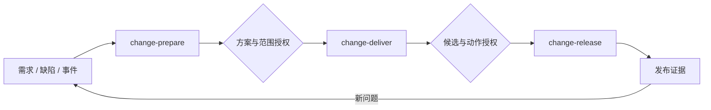

# 智能 Harness 脚手架：技术设计

日期：2026-11-02。状态：待评审，未进入产品实现。
需求依据：[需求与约束基线](../../requirements/2026-11-02-smart-harness-requirements.md)。

本文决定模块的 Interface、生成过程、skill 工作单元、流程协议、审批与恢复方式。名称、数据结构及默认策略是本次设计提案，不代表用户已经批准，也不代表上游工具已验证支持。

## 1. 方案与关键决策

### 1.1 从参考资料采用什么

- Anthropic 的长任务研究使用结构化交接及生成/评估分工，并在后续实验中删减不再必要的流程结构。本方案采用可恢复产物、显式完成标准和按需独立评估，不固定采用三 agent、sprint 或高频全量评审。[研究原文](https://www.anthropic.com/research/harness-design-long-running-apps)
- Harness Engineering 将事前引导和事后检测放在一起讨论。本方案让项目规范与真实检查相互关联，快速反馈嵌入研发循环，长期策略修改另行审阅。[文章原文](https://martinfowler.com/articles/harness-engineering.html)
- AI-native SDLC playbook 强调可衔接的产物、自动交接和必要的人类决策。本方案合并流程步骤，以审批和业务判断确定停顿点，并声明每项产物的权威来源。[Playbook](https://claude.com/resources/articles/the-ai-native-sdlc-playbook)

以下模块、skill 数量、状态模型与审批合并算法是针对本产品的设计，不是三篇资料给出的标准实现。

### 1.2 核心选择

采用“安装时编译、研发时由宿主执行”的架构：

1. CLI/MCP 分析项目并解析用户选择。
2. 将内置流程模板、所选 SDD 能力、客户扩展和反馈入口编译成宿主可执行的 skills。
3. 宿主 coding agent 执行连续工作，使用文件产物交接和小型状态 helper 记录进度。
4. Git hooks、检查命令、GitLab 权限和流水线执行确定性约束；CLI 不常驻调度研发。

不按 Plan/Design/Build/Test/Review 六个名词机械安装六个公开 skill。步骤和中间产物可分开，用户入口只在工作目标或需要人类决策的接缝处划分。

不为每个环节启动独立 agent。规划、实现和评估是内部角色；评估是否需要独立上下文，由项目评审政策和宿主能力决定。

### 1.3 决策责任

脚手架自动化安装配置和已有能力接线。它不建设客户测试体系、不制定架构和业务规则、不替客户作发布决策。

生成的研发 skill 可以在开发者发起且授权的任务内修改业务代码、编写相应测试；这不扩大 setup/update 的职责。

本设计默认建议：TypeScript 实现、单 Git 仓库状态边界、项目级安装优先、每项目一个主 SDD 框架、macOS/Linux 先行。同项目可安装多种 agent。上述默认值仍待确认；跨仓库和 Windows 完整兼容不纳入首版承诺。

## 2. 模块与生成机制

### 2.1 模块分工与调用顺序

```text
CLI / setup MCP
  → Project Discovery
  → Analysis Runtime
  → Resolver + Flow Compiler
  → Install Plan
  → Plan Executor
  → Manifest + Installation Report

安装后的宿主 agent
  → 生成的 SKILL.md 与 references
  → 所选 SDD 原生能力 / 客户扩展
  → 项目检查命令、Git、CI
  → 产物、反馈、流程 checkpoint
```

Project Discovery 的 Interface 为 scan(root) → ProjectSnapshot。它确定 Git 根、受忽略文件、模块、现有配置和输入摘要，不调用模型，不改项目。

Analysis Runtime 的 Interface 为 analyze(snapshot, questions) → AnalysisResult。独立模式用模型运行时，宿主模式用当前 agent；返回带证据的结论和未知项，不直接执行安装。

Resolver/Compiler 的 Interface 为 compile(snapshot, analysis, selection, registry) → CompiledBundle。它隐藏各框架、宿主和客户能力差异，返回具体绑定、文件内容、验证要求及无法满足的条件；无安装副作用。

Plan Executor 的 Interface 为 apply(planId) → InstallationReport。它隐藏目录创建、配置合并、工具调用、幂等、恢复和远端变更细节；只能执行计划中已列出的动作。

Flow State 的 Interface 为 read / checkpoint / record-evidence / resume。它校验与保存一次研发任务的状态，不决定业务需求、不启动 agent、不执行下一研发阶段。

CLI 与 MCP 调用同一组 Module；不重复实现生成和安装逻辑。日常 skill 不通过 setup MCP 逐阶段推进。

### 2.2 关键数据契约

以下为设计层类型，实际 schema 需要版本化：

```typescript
type ProjectSnapshot = {
  schemaVersion: number;
  repoId: string;
  root: string;
  head: string | null;
  inputDigest: string;       // 包含本次读取的未提交内容
  modules: ModuleFacts[];
  existing: ArtifactRef[];
  checks: CheckBinding[];
};

type AnalysisResult = {
  snapshotDigest: string;
  findings: {
    kind: "explicit-config" | "common-practice" | "local-pattern" | "proposal";
    statement: string;
    evidence: SourceRef[];
    confidence: "high" | "medium" | "low";
  }[];
  unknowns: string[];
};

type Selection = {
  agents: string[];
  framework: string | null;
  tools: string[];
  flows: string[];
  extensions: ExtensionBinding[];
  sourcesOfTruth: Record<string, SourceBinding>;
  policyRef: ArtifactRef;
};

type CompiledBundle = {
  inputDigest: string;
  bindings: ResolvedBinding[];
  generated: GeneratedArtifact[];
  actions: InstallAction[];
  unresolved: Requirement[];
};
```

inputDigest 根据实际读取的源码/配置内容及选项计算，不能只用 HEAD。生成目录、本地运行日志、被忽略的大文件和凭据不进入语义分析输入。源码引用以仓库相对路径和必要范围表示。

事实与政策分开。已有显式配置优先；普遍惯例可形成规范候选，局部历史模式和建议改进不能自动成为阻断规则。

sourcesOfTruth 按需求、规格、实现计划和审批分别声明权威来源。仓库文件可以是正文或客户系统的工作副本，必须记录外部 id、版本和读取时间；源记录变更时重新检查，不能保留两个互不关联的“最终版本”。

### 2.3 Adapter 的 Interface

Agent adapter 提供 probe、render 和 validate：返回 skills 发现方式、入口文档、MCP 注册方式、项目/用户级范围、非交互运行和独立评估能力。Claude Code、Codex、OpenCode、Oh My Pi 分别实现；同项目共用事实和模板，分别渲染。

SDD adapter 提供 resolveCapabilities(version) 和 resolveArtifacts(change)：将语义动作映射为真实 skill、宿主命令或 CLI 操作，同时返回前置条件、原生产物和必须保留的人工决策点。

Tool adapter 提供 planInstall、planInitialize 和 verify；将安装程序、MCP 配置与项目初始化分成独立动作。OpenWiki 和 CodeGraph 不共用一个假设相同的初始化流程。

Environment extension 提供能力描述和入口，例如需求读取、MR 提交、CI 状态、评审意见、部署、状态查询和回退。每项声明读写效果、所需配置、作用环境、幂等键和结果格式。只有真实提供的能力才允许绑定。

Quality recipe 将用户选择的通用工具和既有检查生成对应配置，不实现业务检测语义。

适配器负责差异，Core 负责协议。不要求客户 skill 实现 TypeScript Interface。客户可导入普通 SKILL.md；需要流程调用时补充轻量能力描述并显式绑定。没有描述时只安装为独立 skill，不自动把它接入有副作用的阶段。

SDD 的最小内部能力集合为 draft-spec、plan-work、implement-work、verify-work、close-change。manifest 可将一个能力映射到多个原生调用，也可将多个能力合并到同一次原生操作；verify/close 等能力不存在时按具体 flow 的必需性报告 unresolved 或使用明确绑定的项目检查，不能发明上游命令。每个映射附产物角色、必需 gate 和受支持版本范围。

framework 为 null 时仍可安装知识工具、hooks、harness-configure 和独立客户 skill。change-prepare/change-deliver 需要所选框架或用户显式提供的兼容能力绑定，否则不安装这两个可执行入口；不隐式生成一套自有 SDD。change-release 可读取符合交付契约的外部候选，但仍需真实部署能力及动作授权。

### 2.4 流程编译

内置 FlowSpec 是有序工作段及条件分支的模板，不是供用户编辑的 DAG 平台。它包含：

- 输入和产物角色；
- 内部步骤与所需能力；
- 执行范围、检查、循环预算；
- 人类决策条件及恢复入口；
- 对宿主能力的要求。

编译顺序固定：

1. 选择内置 flow，解析项目上下文和权威来源。
2. 解析所选 SDD 的版本、真实能力和原生产物。
3. 绑定客户系统、检查与部署能力。
4. 合成客户政策、平台限制和上游必需 gate。
5. 计算有效决策点，合并可以一起审阅的决策。
6. 渲染 SKILL.md、references、配置和必要 helper。
7. 校验无悬空引用、未绑定副作用、缺失必需能力或矛盾政策。
8. 输出安装计划和差异，不在编译中直接安装。

原生 skill 调用保留其必须遵守的约束。能通过上游支持的 preset/配置调整的行为由 adapter 显式适配；不可调整的原生 gate 在同一公开 skill 内暂停，不擅自跳过，也不因此新增公开入口。安装报告展示实际 gate 集合。

### 2.5 安装计划与事务范围

每个 InstallAction 至少包含 id、kind、dependsOn、目标、beforeDigest、desiredDigest、参数、验证方式和 idempotencyKey。kind 限定为文件合并、工具安装、项目初始化、明确的远端配置和验证。

文件先生成候选内容，再按所有权合并。全量托管文件三方合并，混合文件只改拥有的结构键/标记块，用户 skill 默认只读校验；工具内部状态只能通过官方接口维护。

每仓库一个安装写入锁。执行前校验输入和目标摘要，动作完成后记录后置条件。恢复先检查实际效果，尤其是包已安装、MCP 已注册或远端资源已创建的情况，避免重复副作用。

单文件原子替换，多文件使用日志和备份。外部调用不承诺整体回滚，失败报告列出已完成效果。无法证明所有权的文件不自动接管；缺失本地 state 时从锁文件、实际安装和远端状态重建。

## 3. Skill 清单与人类决策点

### 3.1 首版公开入口

首版建议四个公开 skill：

1. harness-configure：项目 harness 的首次接入与增量更新。
2. change-prepare：将需求、缺陷或事件整理成可执行的变更方案。
3. change-deliver：实现、验证、评审、提交，并将变更推进到可集成/可发布状态。
4. change-release：执行已授权的集成/发布动作并验证结果。

harness-improve 是后续可选入口，用于提出 harness 策略改进，不属于首版必装能力。

不另设公开的 code-review、test-run、ci-fix、handoff、resume、bug-fix、incident-triage 等 skill：检查/评审/修复是内部步骤，恢复是每个入口的共同参数；缺陷和事件从 change-prepare 的不同输入模式进入。上游自带 skills 仍按框架方式安装，这里只限定本产品新增的公开流程入口。

用户可停用任意入口或显式选择兼容的自定义入口。停用某段后，前段在交接包中明确指出由用户/外部流程接手，不假设后段存在。

### 3.2 harness-configure

输入：仓库、init/update 模式、目标 agents、框架、工具、扩展和已有用户配置。

连续执行：发现 → 分析 → 选项补齐 → 编译 → 差异计划 → 安装 → 初始化 → 接入验证。

产物：ProjectProfile、Selection、版本锁、生成清单、宿主配置、检查接线、安装报告和开发者待办。项目业务代码及测试体系不在输出范围。

只因缺少有影响的选择/凭据、配置冲突、超出原授权的写入或政策决策而询问用户。已明确授权的同范围安装不逐项重复确认。CLI 和该 skill 是同一安装生命周期的两种入口，不是两套 setup 工具。

独立 CLI 先探测并装载适配器再执行；宿主模式由最小 bootstrap 先注册此 skill 和 setup MCP，随后使用同一生命周期生成其余产物，避免首次配置依赖尚未安装的完整环境。

### 3.3 change-prepare

输入：自然语言需求、工单、缺陷/事件证据，或已有规格；附目标仓库和 changeId。已批准的输入附权威来源与版本。

连续执行：

1. 读取规范、as-is 和代码关系，核实相关现状；缺陷模式增加复现与根因调查。
2. 明确范围、非目标、验收依据、风险和待定业务决策。
3. 对比方案并产出技术设计：数据/Interface 变化、影响范围、兼容与迁移、失败/回退处理。
4. 形成实现计划、可验证完成条件、执行范围和所需客户能力。
5. 内部一致性评估，修正无须人决定的问题。
6. 汇总未决事项与构建授权请求，交付一次可审阅的方案包。

产物角色为 intent、design/spec、plan、acceptance、risk；实际路径由 SDD adapter 返回，不强制另造五份同义文件。一个原生文件可以承担多个角色。

正常停止点是“方案与实施范围需要人决定”。若完整输入和实施授权已经存在且仍有效，则不重复请求审批，直接交给 change-deliver。业务含义不清或必须先选择技术路线时可提前询问，但不能因“写完一个文档”而停顿。

本段可修改规划文档，不修改业务实现。缺少项目测试时说明验证缺口，不将建设整个测试体系塞进计划；具体需求确实需要的测试工作由开发者确认其范围。

### 3.4 change-deliver

输入：已接受且未失效的方案包、实施授权、工作分支与框架产物。

连续执行：

1. 校验范围和输入版本，建立隔离工作区或复用客户指定分支。
2. 按计划实施；可按能力和风险拆成内部工作项，不固定引入 sprint。
3. 运行已有检查，针对本次需求执行授权的测试工作。
4. 以完成标准评估，按政策执行需要的独立评审；修复问题并复验。
5. 在允许范围内提交并创建/更新同一 MR，读取 CI 和 AI CR。
6. 对依据充分的同范围问题修复、推送、重新检查，直到形成可交付候选。
7. 准备部署/回退说明及审批所需证据，交接给 change-release。

不在实现、测试、评审和 CI 修复之间要求用户重启 skill。CI 未返回时等待或记录 awaiting_external；上下文不足时写交接点；预算用尽或问题需要业务决定才交接给人。

产物：diff/commits、检查记录、评审结果、MR、候选清单和未解决项。候选清单绑定具体提交、内容摘要和可获得的构建 artifact；有问题的候选不标为 ready。

独立评估在客户政策要求或选定评审模式下执行。宿主可使用独立上下文或外部 CI reviewer；只在同一上下文换个角色不能声明“独立评审”。必需评审能力缺失时报告阻塞，不悄悄降低要求。

发布前的集成是否由本段执行，取决于客户实际效果：普通非生产集成可预授权；若合并会触发生产发布，则在合并前进入对应发布 gate，不能先合并再请求授权。

无 MR/CI 扩展时，使用显式的 local 交付模式：完成本地实现、检查、评估和候选记录后结束，不声称 MR/远端 CI 已完成。gitlab 模式增加 MR、CI/CR 循环；若项目政策要求远端检查，则不能降为 local 规避门禁。两种模式由编译结果写明，不影响其他独立工具的安装。

### 3.5 change-release

输入：可交付候选、目标环境、有效动作授权，以及客户扩展提供的集成/部署、状态查询和回退入口。

连续执行：复核候选与审批 → 需要时合并 → 部署指定 artifact → 等待部署状态 → 运行已有冒烟/健康检查 → 在授权条件内回退或记录发布成功。

默认采用不可变 artifact 交付：change-deliver 通过客户已有构建入口产出 artifact，并在请求发布批准前冻结其摘要。change-release 只部署该对象，不以同名 tag 或当前分支重新构建替代。无构建/部署能力时可以完成本地交付，但不能报告已准备好自动发布。

客户采用“合并后构建”时，release 包含明确的 preflight 子步骤：先取得集成授权并合并，等待客户流水线构建，把新 artifact 和检查结果记入候选，再取得所需发布授权；同一 skill 内续跑。合并若会直接发布且无法在 CI 中阻断，则不支持这条自动发布路径，必须由客户调整门禁或改为外部人工发布。不能对尚不存在的构建产物无条件授权。

发布授权必须涵盖即将发生的真实效果；开发/测试环境可以按客户政策预授权。生产授权默认建议由客户指定负责人提供。已有有效授权时直接继续，不因进入新 skill 再问一次。

部署失败时区分重试、已授权回退和需要代码修改。前两者在 runbook/预算内执行；代码问题回到 change-deliver，同范围修复不重复讨论全部需求，但旧候选授权失效。新范围或不可逆处理重新交给人。

产物：部署 id、artifact/commit、目标环境、运行检查、回退结果和发布记录。缺少客户部署能力时报告“未接入”，不生成虚假的部署命令；该入口按需安装。

### 3.6 合并与暂停的规则

默认建议只有两个业务决策包：方案/实施授权，以及候选/集成发布授权。它们不是强制两个审批次数。

对每个有副作用动作按客户政策求值：

```text
已有授权覆盖当前对象、动作、环境和版本 → 连续执行
必须人决定且缺少有效决定                 → awaiting_human
必须外部审批/检查尚未返回                 → awaiting_external
被政策禁止、必需能力缺失                 → blocked
```

同一负责人可以在同一时点看完、且证据全部已就绪的决策合并为一个请求。不同审批人、不同就绪时机、职责分离要求和上游不可取消的 gate 必须保留。代码 owner 审批、变更委员会或生产审批若是客户现有要求，就是真实 gate，不能为减少次数而绕过。

自动步骤的分段、检查失败、上下文切换和 skill 加载都不自动产生人工审批点。技术阻塞仍可能终止自动执行，但应交付原因和恢复入口，不能伪装成人工批准即可解决。

示意主线：



图中决策若已被有效授权覆盖，则自动通过；客户额外必需 gate 在相关动作之前插入，不增加公开 skill。

## 4. 流程协议与长期运行

### 4.1 持久化布局

```text
.harness/
  config.yaml                       # 选择、政策和权威来源引用
  lock.json                         # adapter/框架/工具/模板版本
  project-profile.json              # 事实及证据
  controls.yaml                     # 检查绑定
  skills/<flow>/                    # 规范来源，adapter 再渲染宿主版本
  runtime/                          # 生成时携带的状态 helper
  changes/<changeId>/
    change.yaml                     # 流程记录与原生产物引用
    handoff.md                      # 恢复所需摘要
    delivery.yaml                   # 候选和交付证据引用
    release.yaml                    # 适用时保存发布结果引用
  state/runs/<runId>/                # 本地锁、日志、临时执行结果；不入库
```

SDD 原生规格、任务文件仍在框架目录；客户系统的权威记录仍在客户系统。change.yaml 存角色引用和版本，不复制第二套可独立漂移的规格正文。跨框架在途产物不自动迁移。

流程记录在有意义的交接/决策/提交检查点随工作分支保存；MR/CI/审批原始记录留在权威系统。凭据、完整会话和原始日志不提交。

运行中的共享状态位于 Git common dir 下的 harness/changes/<changeId>/，包含 current.json、lease.json 和动作日志，所有本机 worktree 指向同一位置。分支内 change.yaml 是可审阅和跨会话交接的投影，不是多个 worktree 各自维护的运行权威。无本地共享状态时从最新交接产物及远端事实重建，并重新验证门禁和未完成动作。

### 4.2 ChangeRecord 契约

```yaml
schemaVersion: 1
changeId: example-change
kind: feature                 # feature | bug | incident | maintenance
phase: prepare                # prepare | deliver | release
status: awaiting_human
sequence: 4
framework: selected-profile
inputs:
  sourceRefs: []
  snapshotDigest: "<digest>"
  policyDigest: "<digest>"
artifacts:
  intent: { uri: "<native-or-external-ref>", digest: "<digest>" }
  design: { uri: "<native-ref>", digest: "<digest>" }
  plan: { uri: "<native-ref>", digest: "<digest>" }
scope:
  allowedPaths: []
  allowedEffects: []
  exclusions: []
progress:
  completedItems: []
  activeItem: null
  unresolved: []
evidenceRefs: []
gateRefs: []
next:
  action: accept-solution
  reason: "<decision-needed>"
```

这只是数据形状示例，不是可以直接执行的客户配置。范围和政策由真实输入填充，空字段不意味着允许全部路径或动作。

状态限定为 ready、running、awaiting_human、awaiting_external、blocked、succeeded、failed。phase 与 status 分离；succeeded 只表示该工作段完成，release 的部署失败不能被 deliver 成功掩盖。

每次 checkpoint 必须带 expectedSequence 和输入摘要。helper 用仓库/变更 id 锁加序号校验，原子写入，过期写者重读后再决定。安装锁与研发变更锁分开；不同变更允许独立运行，同一变更不能有两个写者覆盖状态。

写入锁之外，还需贯穿一段执行的 run lease：开始前 claim(changeId) 获取 ownerRunId 和 fencingToken，受控动作在执行前验证 token，动作意图先入日志再产生远端效果，checkpoint 也必须携带 token。进入人工/外部等待或正常结束时显式交接/释放执行权。进程中断后不因超时自动抢占，恢复者先核实旧执行已停止并对账在途动作，再生成新 token；旧写者和旧 token 被拒绝。

首版 lease 保证范围是同一 Git common dir 的本机 worktrees，不提供分布式锁服务。客户 CI 对同一 change 串行唤起；跨机器的外部写操作还必须依赖远端版本条件、动作幂等键和平台侧串行机制。发布扩展若不能提供这些保证，就不开放重叠自动发布，转为外部受控发布。任意人工绕过 helper 的操作不在工作流一致性保证内，仍由平台权限保护。

### 4.3 产物、证据与授权的绑定

检查记录绑定检查版本、命令、环境、代码内容摘要和阶段；commit 尚未产生时绑定工作区内容摘要，提交后补充对应 commit。证据不能只写“测试通过”。

delivery.yaml 的最小契约包含 changeId、方案/政策摘要、commit/tree 摘要、必需检查与评审证据、MR、artifact 的不可变摘要（如已构建）、目标动作、未决问题和 ready 状态。candidateDigest 对这些引用和版本做规范化摘要；ready 必须带 local-delivery、integration 或 release 的目标，不能用“本地可交付”冒充“可发布”。缺少该目标的必需结果时 ready 为 false。若目标动作需要的 artifact 尚未产生，不能对未知 artifact 请求无条件发布批准。

决策请求包含待决定事项、范围/风险、候选摘要、将发生的动作、目标环境、验证及回退条件。已有授权的复用必须匹配这些对象。

GateRequest 的必填字段为 id、changeId、subjectDigest、policyDigest、effects、environment、requiredAuthorities 和 evidenceRefs；GateDecision 记录 requestId、decision、决策来源/外部 id 及有效条件。方案级 subjectDigest 指向方案包，动作级指向具体候选及目标；helper 记录引用，受保护动作执行前由 extension 向权威系统复核。

发布动作的 subjectDigest 由不可变 artifact、源码树、目标环境、runbook/回退范围及政策摘要组成，不由可变分支名或 tag 代替。合并后若源码树或 artifact 改变，重新检查并请求该对象所需授权。仅 commit 元数据改变而源码树、artifact、目标和政策均可证明一致时，可按政策复用发布授权；受合并基线影响的检查仍需重跑。交付候选的审计记录同时保留合并前后 commit，不要求为纯元数据变化制造新的人工审批。

规格、政策、关键依赖或实现内容变化会使相关批准或检查失效；只失效实际依赖的部分，不无差别重做全部流程。代码内容修改一定使旧交付候选失效；重新构建 artifact 不同则不能沿用原 artifact 的发布授权。

审批记录不是权限凭据。客户要求强制审批的动作由 GitLab/部署系统等权威系统核实并执行；本地 YAML 中的 approved 字段或模型声称“已批准”不能取得生产权限。对话中的方案确认用于工作流意图，不能替代受保护分支或生产环境授权。

### 4.4 续跑与上下文切换

每个公开 skill 支持 changeId 的续跑，不另设 resume skill：

1. 读取 change.yaml、handoff.md、原生产物及权威状态。
2. 验证仓库、源码、政策和能力绑定版本。
3. 重查正在进行的远端动作，确认实际完成、失败或仍在运行。
4. 定位首个未完成且前置条件有效的工作项。
5. 同段续跑或加载已安装的下一段 skill；只有真实决策缺失才询问用户。

handoff.md 记录当前目标、已完成/未完成、证据引用、失败调查、下一步和权限限制，不复述全会话。上下文切换按需要发生，不强制每个工作项重启 agent，也不把模型上下文压缩视为批准失效。

当前会话中用户给出决定后直接恢复并衔接下一段，无需再输入下一条 skill 命令。宿主进程结束后不能假装 skills 会自行运行：无后台驱动时由用户续跑；配置客户 CI/webhook 驱动时由该系统重新唤起。CLI 不承担常驻调度。

Flow State helper 建议使用产品声明的 Node 运行时，以独立脚本随生成产物分发，仅做文件协议和校验；确定性 hooks/项目检查仍直接调用项目原生入口，不依赖此 helper 或模型在线。

### 4.5 外部动作、等待与失败

创建 MR、触发流水线、部署等动作使用 changeId、分支、候选摘要等组成幂等键。超时后先查询实际结果，再决定重试，避免重复 MR 或重复发布。远端完成但本地记录丢失时按幂等键恢复。

同范围机械失败继续内部修复，不触发新的人工 gate；规则冲突、验收含义变化、超出授权范围、需受保护路径/不可逆操作时形成具体决策请求。

预算建议包括总耗时、模型预算、无进展轮次和重试上限；默认最多三轮连续修复作为可调整提案。需要人判断时提前停止，不通过放宽检查和改写验收标准制造成功。等待外部系统与耗尽主动修复预算分别记录。

## 5. 接入与工程反馈实现

### 5.1 上游能力如何接入

OpenWiki：安装与 MCP 注册后使用官方生命周期生成/更新 as-is，不改写其内部 Claims、索引或运行状态。GitLab include 调用已验证的非交互入口，使用独立凭据，过滤纯生成文档变化并串行更新，产出文档 MR。

CodeGraph：分别执行工具安装、目标 agent 注册和项目初始化，验证索引状态及 MCP 握手。本地索引不默认提交；无源码时记录 deferred。Pi 与 Oh My Pi 不混同，缺少原生安装目标时由实际宿主能力适配，无法满足则报告不支持。

SDD：以版本化 capability manifest 声明真实调用、产物角色和 gate。Superpowers、OpenSpec、Spec Kit 各自映射到同一组内部工作意图，但不假定它们拥有同名 skill、相同目录或等价审批约束。

客户扩展：读需求、提交 MR、查询 CI/CR、部署/回退分别可选。没有部署扩展时不安装可执行发布入口；没有工单集成仍可用人工输入。自定义 skill 的普通安装与有副作用能力绑定分开。

### 5.2 Git hooks 与静态检查

安装先读取原 hook manager、core.hooksPath、现有 hook、包管理器和安装脚本。优先合并已有方案，避免重复管理器和覆盖原 hook；新工具仅按用户选择安装。

pre-commit 调用已选的暂存格式/lint 等快速检查；pre-push 调用既有模块类型检查、构建和快速测试；commit-msg 仅按客户消息政策接入。参考预算为 10/60 秒，超出则明确调整阶段，不把超时当通过。

检查对象必须正确：

- pre-commit 针对暂存快照，保留部分暂存与未暂存修改，覆盖删除、重命名和特殊路径。
- pre-push 根据真实 ref 更新确定范围，检查实际待推送内容；工作区不匹配时使用隔离快照，处理新分支和多 ref。
- hooks 可绕过，不能作为唯一远端门禁；每 clone 的安装与启用由 doctor 单独验证。

通用 formatter/linter、类型/编译、安全扫描可以接入现有配置或所选预设；专属架构检查只绑定开发者提供的命令。项目级类型检查不传入 lint-staged 自动追加的文件参数，不默认全仓库自动修复。

### 5.3 测试接线与阶段检查

setup 只发现既有 runner、命令、环境要求和报告，并接入 hooks/CI/skills。缺失测试时报告输入要求，不创建测试目录、runner、fixtures 或测试环境。新项目同样遵守。

change-deliver 可按该需求已确认的范围新增/修复测试，属于研发，不是 setup 补齐测试体系。验收依据仍由开发者和项目政策提供。

同一 CheckBinding 定义 id、命令参数、cwd、环境引用、输入范围、阶段、超时、是否必需和报告解析器。执行时保留原始退出码，输出 pass、fail、error、skipped、not-applicable，后者需适用性证据。缺结果、零测试或全 skipped 不当作行为验证成功。

本地和 CI 引用相同真实项目入口。CI 为既有命令及所选通用检查生成 include，保留失败报告，不用 || true 或错误 allow_failure 吃掉失败。JUnit 上传不自动决定 job 状态；MR 合并条件由客户已确定政策和远端配置实施。

安装完成报告至少分别列出：配置生成、工具安装、hook 启用、命令调用验证、项目检查结果、远端门禁验证和开发者待办。业务测试失败不触发 installer 修改业务代码。

### 5.4 评估与自纠正

内部评估读取已批准的完成标准，核对实际代码、运行行为及证据，不把实现者自评当最终事实。确定性检查先行；语义评审处理工具未覆盖的问题，按客户要求选择独立上下文，记录结论的不确定性。

修改后重跑受影响检查，段落交付前运行该阶段全部必需 gate。评审政策和证据不足时报告缺口，不自行更改测试覆盖门槛、架构约束或将历史失败加入豁免。

长期重复问题可以生成 harness-improve 提案：修改规范、skill 或检查接入方案。政策变更经用户审阅和相关回归验证；需要业务测试/专属规则时生成开发待办。项目测试质量与脚手架接入质量分别衡量。

## 6. 端到端示例与验证

### 6.1 一次普通功能变更

以已有 lint、构建、测试入口及 GitLab 的老项目为例：

1. 用户输入“订单列表增加状态筛选”。change-prepare 连续读取现状、确认语义、形成设计、计划和验收包。
2. 用户接受范围和实施方案。当前宿主直接加载 change-deliver，不要求用户手动启动“代码生成”。
3. 实现后单元检查失败，agent 修复并复验；内部评审发现边界问题，在同一段处理。
4. 按授权创建同一 MR，CI 失败后修复并更新 MR，结果绑定新 commit。
5. 形成候选清单。若客户要求 code owner 批准，则停在相关集成动作前；若合并会触发生产发布，则发布 gate 必须已在合并前成立。
6. 权威审批就绪后继续 change-release，部署指定 artifact，调用已有健康检查并记录结果。需回退时仅按已授权 runbook 执行。
7. 新缺陷或运行事件携带证据回到 change-prepare 的 bug/incident 模式，无需新增一套运维 skill 流程。

如果第 3 步发现项目根本没有约定的测试入口，记录验证缺口并按必需检查政策处理；不能由 setup 安装阶段悄悄补完整测试体系。

### 6.2 安装与编译验证

- 同一 snapshot/selection/registry 编译结果稳定；任一输入变动使摘要变化。
- 四种 agent、三种 SDD 的绑定和额外 gate 在计划中可见，无悬空引用。
- 同项目多 agent 的生成文件不互相覆盖，共享同一事实来源。
- 已有配置和自定义 skill 合并可恢复；重复安装无重复配置。
- 工具安装、项目初始化、MCP 可用性分别验证；无环境时只报告已验证部分。
- 客户扩展缺失、不兼容或凭据不足时，只阻塞依赖该能力的工作段，不伪造功能。
- 开放文件合并和外部安装失败恢复的契约测试，不仅验证模板文本长得正确。

### 6.3 流程与恢复验证

- 直接批准输入时不重复询问；真正未决的业务问题集中形成决策请求。
- 实现、测试、评审和 CI 修复在同一 skill 中连续执行，只有真实 gate 才请求人判断。
- 源码内容或相关输入变化使旧检查/候选失效，新 artifact 使原发布授权不能直接复用；纯 commit 元数据变化只按受影响依赖重新验证。
- 修改本地批准字段不能越过远端保护或获得生产权限。
- kill/restart 后依赖持久产物恢复，远端已建 MR/已触发部署不重复创建。
- 旧 sequence 的状态写入被拒绝，同一 change 不出现两个覆盖状态的写者。
- 同机多个 worktree 共用状态与执行 lease；旧 fencingToken 不能继续受控动作，接管先对账在途远端操作。跨机器写入依赖的平台约束单独验证，不宣称拥有分布式锁。
- 宿主无独立评审或某种 hook 能力时，明确替代路径或 blocked，不冒充等价支持。
- 总预算或无进展上限触发可恢复交接，不删检查、不降验收标准来结束任务。

### 6.4 验证职责与实施顺序

脚手架自己的测试使用隔离仓库和 fixtures，验证合并、绑定、状态、暂存区、退出码及报告，不向客户业务代码注入缺陷。客户测试用例和验收策略由开发者提供。

建议实施顺序是先贯通一个宿主、一个 SDD、一个 GitLab 接入的纵向链路，验证生成到恢复；再补四宿主/三框架矩阵和可选发布适配。完整首版仍按四种宿主与三种框架验收，不能将阶段演示宣称为全部兼容。

实现前锁定上游版本并验证实际路径、skill 调用、非交互能力和审批约束；库选择和内部文件拆分可以调整，不改变本设计的模块 Interface、产物协议和职责。

## 附录：参考与兼容性依据

- [Anthropic：Harness design for long-running application development](https://www.anthropic.com/research/harness-design-long-running-apps)
- [Birgitta Böckeler：Harness engineering for coding agent users](https://martinfowler.com/articles/harness-engineering.html)
- [Anthropic：The AI-native SDLC playbook](https://claude.com/resources/articles/the-ai-native-sdlc-playbook)
- [OpenWiki](https://github.com/langchain-ai/openwiki)、[CodeGraph](https://github.com/colbymchenry/codegraph)
- [Superpowers](https://github.com/obra/superpowers)、[OpenSpec](https://github.com/Fission-AI/OpenSpec)、[Spec Kit](https://github.com/github/spec-kit)
- [Git hooks](https://git-scm.com/docs/githooks)、[lint-staged](https://github.com/lint-staged/lint-staged)、[pre-commit](https://pre-commit.com/)、[Husky](https://typicode.github.io/husky/get-started.html)
- [GitLab unit test reports](https://docs.gitlab.com/ci/testing/unit_test_reports/)

本设计不把参考资料里的示例技术栈、角色数量和审批流程直接作为本产品默认值，也不把兼容性方向当作已验证的工具版本支持。
